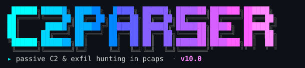

# c2parser



Passive C2 and exfiltration detection for packet captures. Point it at a `.pcap` / `.pcapng` and it reports beaconing, framework default profiles, SMB named-pipe pivots, DNS tunnelling, upload-heavy exfil, DCE/RPC lateral movement and AD reconnaissance. Each finding comes with a scored list of the evidence behind it and the Wireshark frame numbers to check it.

It never sends traffic or touches hosts. It reads the capture and nothing else.

## Install

Download a binary from [Releases](../../releases), or build from source (Go 1.24+):

```sh
go build -o c2parser .
./c2parser -version
```

On macOS, clear the download quarantine flag first: `xattr -d com.apple.quarantine c2parser-*-darwin-*`

## Usage

```sh
# Analyse a capture (text report, findings ≥ 0.20)
c2parser capture.pcapng

# Several captures, 4 at a time (memory ≈ 4 × one capture's peak)
c2parser -j 4 day1.pcap day2.pcap day3.pcap

# JSON for scripting: high-confidence findings only
c2parser -json capture.pcap | jq -r '.[].findings[] | select(.score >= 0.6) | "\(.severity)\t\(.score)\t\(.title)"'

# Air-gapped: no SigmaHQ update, built-in and cached rules only
c2parser -offline capture.pcap

# CI / triage gate: exit code 2 if anything reaches high or critical
c2parser -offline -fail-on high capture.pcap

# Add your own indicators (ip:, domain:, ja3:, ja3s:, ja4:, cert: sha256; '#' starts a label)
c2parser -ioc iocs.txt capture.pcap

# Show everything, including weak signals and per-protocol tables
c2parser -v -min-score 0 capture.pcap

# Tell it about your network: extra internal ranges and known domain controllers
c2parser -add-internal 100.64.0.0/10 -dc 10.0.0.5,10.0.0.6 capture.pcap
```

Example `iocs.txt`:
```
ip:203.0.113.10        # suspected teamserver
domain:cdn-update.example
ja4:t13d1516h2_8daaf6152771_02713d6af862
```

## Example output

```
[1] CRITICAL 1.00  HTTP C2 192.168.1.32 → 100.113.27.34:80 (Host: 100.113.27.34)
    category: C2 channel | 2024-04-01T13:45:03Z → 2024-04-01T13:58:27Z
    • sig:havoc-demon-header             1.00×0.97  havoc-demon-header framing in 470 of 940 HTTP bodies
    • hdr:ua_c2_default                  1.00×0.75  User-Agent is the Havoc default (470/470 requests)
    • random_payloads                    1.00×0.55  55 bodies statistically indistinguishable from random
    • beacon_timing                      0.42×0.65  470 client bursts, median gap 1.88s, MAD jitter 7%
    ↳ frames: 78, 193, 345, 415 …   (Wireshark: frame.number in {78 193 345 415 …})

[2] CRITICAL 1.00  Named pipe \\192.168.1.11\IPC$\gainz on 192.168.1.11 (client 192.168.1.32)
    category: SMB named-pipe C2 / pivot
    • c2_framing_in_pipe                 1.00×0.97  Havoc Demon framing (0xDEADBEEF) found 51 times in pipe data
    • pivot_from_c2_host                 1.00×0.50  client 192.168.1.32 also has an active C2 channel
```

Each bullet is `score × weight` for one signal. Signals are combined by noisy-OR into the finding's score; severity follows the score.

## Useful flags

| Flag | What it does |
|---|---|
| `-json` | Machine-readable output (findings, host risk, HTTP/SMB/DNS summaries, `rpc_calls`) |
| `-min-score 0.4` | Hide findings below this score (default 0.20) |
| `-fail-on high` | Exit 2 if any finding reaches this severity |
| `-offline` | Never touch the network |
| `-j N` | Analyse N capture files in parallel |
| `-ioc file` | Match your own indicators |
| `-internal` / `-add-internal` | Set or extend the internal CIDRs |
| `-dc ips` | Known domain controllers (their replication isn't DCSync; their LDAP isn't recon) |
| `-sigma dir` | Extra Sigma rules on top of the built-in and SigmaHQ sets |
| `-timing v2` | Experimental timing engine (event models, calibrated nulls); `v1` is the default |
| `-no-banner` | Skip the startup banner (also `C2PARSER_NO_BANNER=1`). It only prints to an interactive terminal, on stderr, so pipes and `-json` stay clean; `NO_COLOR` gives a plain version |

`c2parser -h` lists everything. Detection details, the JSON fields and the evaluation tooling are in [`docs/reference.md`](docs/reference.md).

## Sigma rules

On first run c2parser fetches the SigmaHQ network/web rules and caches them, then checks for updates at most once every 24 h. Network failures never stop an analysis. Use `-offline` to skip that, `-update-sigma` to refresh now, and `-sigma-report` to see which rules loaded. The built-in rules in `rules/sigma/` always load.

## Development

```sh
make test       # go vet + go test ./...
make release    # binaries for macOS (arm64/amd64), Linux and Windows in dist/
```

Lab-capture tests skip unless `C2PARSER_TESTDATA` points at a directory of captures. Captures never belong in this repo. The synthetic test corpus lives in `corpus/scenarios/` (see [`docs/corpus.md`](docs/corpus.md)).
